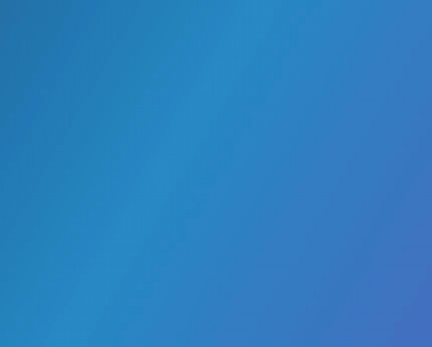
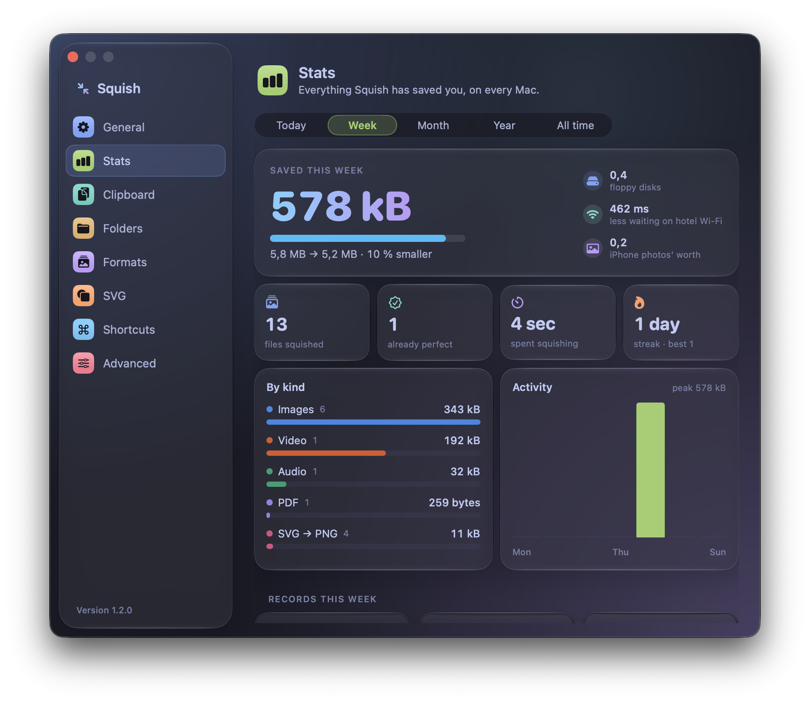
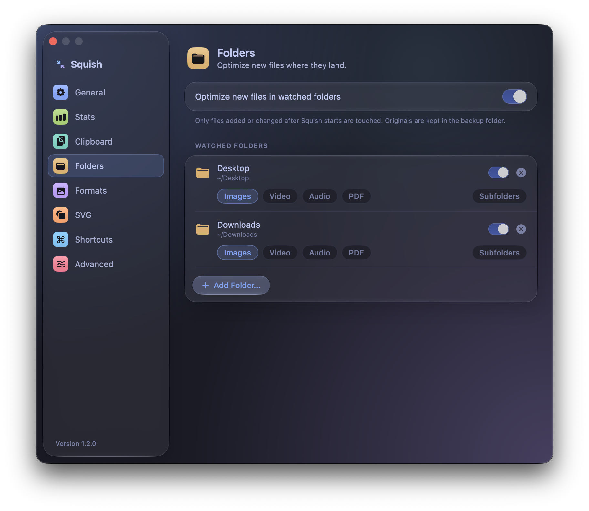
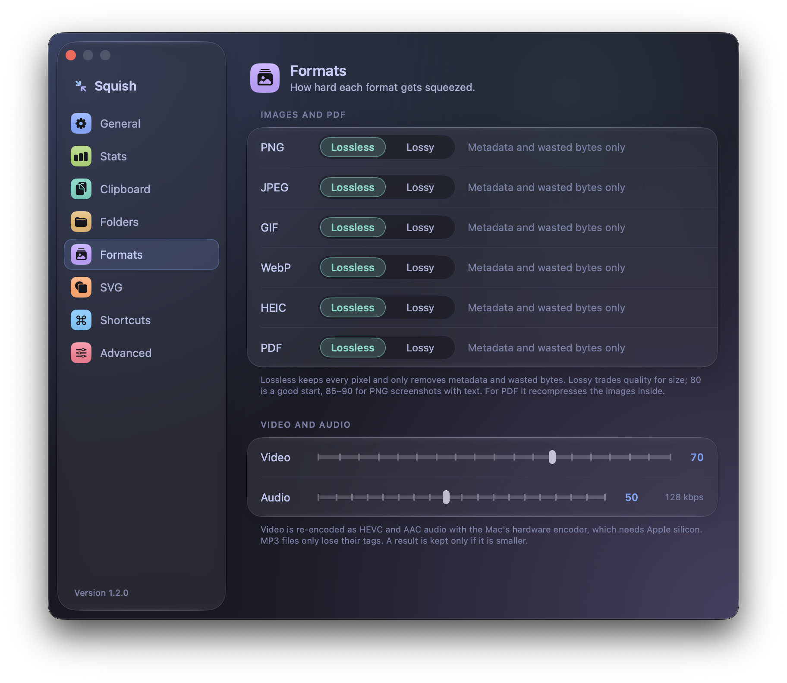
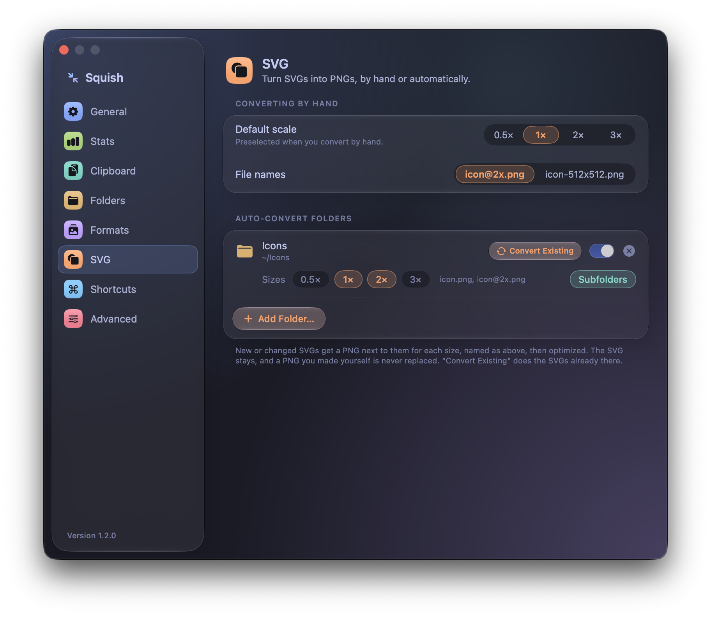

# Squish

A free, open-source macOS menu bar app that makes media smaller. It watches your clipboard and chosen folders, strips metadata, recompresses images, video, audio and PDF, and keeps every original so you can restore it. It also converts SVG to PNG at any scale. Inspired by Clop.

Requires macOS 14 or later. Licensed under the [GNU GPL v3](LICENSE).

<p align="center"></p>

## What it does

- **Clipboard.** Copy an image (PNG, JPEG, HEIC, GIF, WebP, TIFF) and the clipboard gets a smaller version. TIFF, which many apps copy, becomes PNG. Copied files (video, audio and PDF too, when switched on) are replaced on the clipboard by optimized copies; the originals on disk are never touched. Squish marks what it writes and never processes its own output, and skips anything password managers mark as concealed.
- **Folders.** New or changed files in watched folders (Desktop and Downloads by default) are optimized in place once they stop changing. In-progress downloads (`.download`, `.crdownload`, `.part`…) are ignored, cloud placeholders in iCloud Drive or OneDrive are never downloaded, and files already there when Squish starts are left alone. Each folder has its own file types and subfolder setting.
- **Backups.** Every replaced original is kept in `~/Library/Caches/app.squish.Squish/backups` for 7 days (configurable). Restore from the toast.
- **SVG to PNG.** From the menu, by dropping SVGs on the menu panel, or with Finder's **Services › Convert SVG to PNG with Squish**. Pick 0.5×, 1×, 2×, 3× or any scale and see the pixel size live. Output goes next to the SVG as `icon@2x.png` or `icon-512x512.png`, and never overwrites the SVG or a PNG you made.
- **Auto-convert SVG folders.** Under Settings › SVG, add folders (an icons folder, say) and pick one or more sizes for each. Every new or changed SVG saved there gets a PNG copy per size, optimized like any PNG. The SVG stays, a PNG you made yourself is never replaced or duplicated, and **Convert Existing** handles the SVGs already in the folder.
- **Keyboard shortcuts.** Settings › Shortcuts lets you record system-wide shortcuts to optimize the files selected in Finder, convert the selected SVGs to PNG, open the file picker, or pause. Squish reads the Finder selection with Apple Events, so macOS asks once for permission to control Finder.
- **Stats.** Settings › Stats shows what Squish saved today, this week, month, year or all time: by kind, by day, records (heaviest file, best compression, biggest win), streaks, habits, a 30-week heatmap and a breakdown by Mac. Stats sync through the sync folder, one file per Mac, so Macs never overwrite each other.
- **Lossless by default.** Lossy mode with a quality slider per format. Video and audio are always re-encoded, and a result is only kept when it is smaller.
- **Settings sync.** General › Sync settings keeps a `settings.json` in iCloud Drive, OneDrive or any folder. Every Mac using the folder picks up changes within 15 seconds; the newest change wins. Watched folders are stored as `~/…` so the file works on every Mac.

## Screenshots

| Stats | Watched folders |
|---|---|
|  |  |
| **Formats** | **SVG to PNG** |
|  |  |

## Build

You need Swift 6.2 or later (Xcode 26 or its Command Line Tools) and [Homebrew](https://brew.sh).

```sh
git clone https://github.com/vbark/squish.git && cd squish
brew install rustup cmake nasm
Scripts/bundle.sh                 # build/Squish.app, ad-hoc signed
open build/Squish.app
```

The first `Scripts/bundle.sh` also builds the bundled optimizers from pinned source into `Vendor/bin`. That takes about 10 minutes, once. Later builds take seconds. `Scripts/package-dmg.sh` makes `build/Squish-<version>.dmg`.

For a quick loop without bundling: `SQUISH_BIN_DIR=$PWD/Vendor/bin swift run Squish`.

### Tests

```sh
swift test
```

Fixture tests in `Tests/Fixtures` run every format through the real tools and are skipped until `Scripts/build-tools.sh` has run. With Command Line Tools only (no Xcode), pass the testing macro plugin:

```sh
swift test -Xswiftc -load-plugin-library \
  -Xswiftc /Library/Developer/CommandLineTools/usr/lib/swift/host/plugins/testing/libTestingMacros.dylib
```

See [CHANGELOG.md](CHANGELOG.md) for what changed in each version.

## Layout

| Path | Job |
|---|---|
| `Sources/SquishKit` | Settings model and sync file, optimizer protocol, registry and one optimizer per format, tool runner, pipeline with a concurrency limit, backups, folder events, self-write guard, SVG sizing and rendering |
| `Sources/Squish` | The menu bar app: menu panel, toast, settings window and its theme, clipboard and folder services, SVG popup and Services provider, global shortcuts and Finder selection |
| `Tests/SquishKitTests` | Unit tests (registry, settings decoding, stability, loop prevention, folder rules, clipboard rules, SVG sizes and names) and fixture tests |
| `Scripts/build-tools.sh` | Builds pinned optimizer versions from source as universal static binaries |
| `Scripts/bundle.sh`, `Scripts/package-dmg.sh` | Assemble, sign, package and optionally notarize |

Logs go to the unified log under the subsystem `app.squish.Squish.<module>`; filter for it in Console.

## Bundled tools

| Tool | Version | License | Used for |
|---|---|---|---|
| [oxipng](https://github.com/oxipng/oxipng) | 10.2.1 | MIT | Lossless PNG |
| [pngquant](https://github.com/kornelski/pngquant) | 3.0.3 | GPL-3.0-or-later | Lossy PNG |
| [mozjpeg](https://github.com/mozilla/mozjpeg) (`jpegtran`, `cjpeg`) | 4.1.5 | IJG, BSD-3-Clause, zlib | JPEG |
| [gifsicle](https://www.lcdf.org/gifsicle/) | 1.98 | GPL-2.0-only | GIF |
| [libwebp](https://github.com/webmproject/libwebp) (`cwebp`, `webpmux`) | 1.6.0 | BSD-3-Clause | WebP |
| [resvg](https://github.com/linebender/resvg) | 0.50.0 | Apache-2.0 OR MIT | SVG rendering |
| [qpdf](https://github.com/qpdf/qpdf) | 12.4.2 | Apache-2.0 | PDF |
| [FFmpeg](https://ffmpeg.org) | 9.0.2 | LGPL-2.1-or-later | Video and audio, using Apple's VideoToolbox and AudioToolbox encoders |

HEIC and TIFF use macOS ImageIO. FFmpeg is built without `--enable-gpl` and without third-party codecs. `Scripts/build-tools.sh` records the exact source tags and build flags, and serves as the corresponding source for the GPL and LGPL tools.

## Releasing with a Developer ID

The default build is ad-hoc signed, which runs on the Mac that built it. To distribute:

```sh
xcrun notarytool store-credentials squish-notary   # once
SIGN_IDENTITY="Developer ID Application: Your Name (TEAMID)" NOTARY_PROFILE=squish-notary Scripts/package-dmg.sh
```

This signs the bundled tools and the app with the hardened runtime, builds the DMG, notarizes it and staples the ticket.

## Known limits

- Video re-encoding uses VideoToolbox's constant-quality mode, which needs Apple silicon. On Intel Macs video jobs fail and leave the file untouched.
- Lossy HEIC re-encoding drops HDR gain maps.
- MP3 is only stripped of tags; WAV and AIFF are not supported, because changing the format would rename the file.
- Settings sync replaces the whole settings file; there is no per-setting merge.
- Shortcuts for selected files read the selection from Finder only, not from other file managers. Folders in the selection are skipped.
